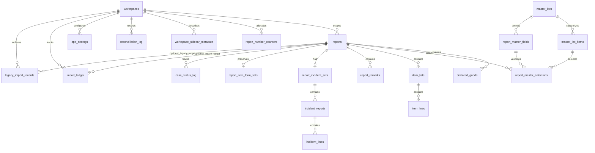

# Proposed schema design and compatibility

## Status and boundaries

[`field_survey_schema_v2_proposed.sql`](../../data/schema/field_survey_schema_v2_proposed.sql)
is a proposal only. It creates a new, empty `field_survey_v2` database and
contains no import of reports, accounts, master-list values, or settings.
It has not been applied to a database. The current Windows application and
its Excel-first storage behavior remain unchanged; MySQL remains an optional
mirror. PDF/Excel templates are unchanged.

The older centralized-account draft was superseded and removed during the
approved 14 November 2026 cleanup. It remains in Git history; the proposal
linked above is the retained design.

## Entity relationship diagram

`v_reports` is an unfiltered compatibility view. The
`v_selected_item_report` view joins only item lists whose form matches
`reports.item_form`; other form data is retained but excluded from current
warehouse calculations.

## Integrity and design decisions

* **Keys and workspace scope:** report IDs are surrogate primary keys;
  `(workspace_id, control_no)` is unique. Master-list entries, logs, and
  optional import links are workspace-scoped; composite foreign keys prevent
  cross-workspace links.
* **Master-data category integrity:** master list categories are explicit.
  The composite foreign key from a report selection to both the allowed
  field/category pair and workspace-scoped item/category pair prevents an
  item from the wrong list or workspace being selected. The report's display
  text is preserved as a snapshot.
* **Repeating sections:** declared goods, remarks, incident cards/lines,
  item forms/lists/lines are normalized into child tables with unique
  per-parent ordering. The UI's five Declared Goods rows and 12 remark rows
  are documented presentation limits, not database truncation limits. Item
  list rows retain the current form's 30-line capability; incident cards use
  the application's 15-line limit.
* **Flexible numeric-looking values:** quantity, price, dimensions, weight,
  and similar values remain text because current controls accept nonnumeric
  formats. Numeric parsing belongs to warehouse calculations and must not
  destroy the original entered value.
* **Dates:** typed incident date is retained in `incident_date_text` even
  when it cannot be parsed; valid values may additionally populate
  `incident_date`.
* **Alternate forms and sidecars:** all item-form lists use shared normalized
  tables, including unselected forms. Sidecar metadata fields preserve source
  control numbers, timestamps, and JSON envelope/version details without
  replacing typed columns. Composite references ensure the incident and item
  form sidecars refer to the same workspace, report, and control number.
* **Cargo ID and Receiving Ref:** both are item-line attributes, not the
  item-list name or a report-level field. Cargo ID is not a visible input on
  the current report form; Receiving Ref is generated for Receiving lines
  during the existing Excel save workflow. Their mappings correct the earlier
  misassignment.
* **Control number counter:** retained only for a future shared-backend
  allocator, where it must be locked and incremented transactionally with
  report creation. It is not the current Excel number source. The actual
  convention is `FSR-YYYYMM-####`, resetting monthly. No restrictive
  check rejects older/imported IDs.
* **No centralized accounts:** `users.json` remains authoritative. No user
  table, credential, account foreign key, or account migration is included.
  The nullable `reports.prepared_by_name` supports the print-name value
  consumed by the PDF generator; it is a snapshot, not an account reference.
  Current Excel data does not persist this print name.
* **No report soft deletion or row-version fields:** neither is required by the
  current application. Foreign keys use `RESTRICT` to prevent accidental
  deletion of referenced records. Future shared editing needs explicit
  transaction/concurrency design; an unused row version would imply a
  conflict protocol the current application does not implement. Master-list
  `is_active` flags merely hide inactive suggestions while retaining their
  referenced identity; they do not soft-delete reports or history.
* **Settings split:** shared aging thresholds are workspace settings;
  per-computer paths, UI preferences, and database credentials remain local.
* **Import support:** phone and legacy import tables define future
  idempotency/traceability structure; phone import rows preserve source
  format/version and unmodeled envelope metadata. The schema script does not
  read or import any source records.

## Application rules to preserve in a future adapter

* New report numbers are generated from the workbook as
  `FSR-YYYYMM-####`, restarting each month. The proposal's text key accepts
  older and imported identifiers; a shared backend may use the counter table
  only with transactional allocation.
* SO Number and Inspection Date are required, SO Number is reusable, and
  Cargo Condition must be selected before save. The database enforces
  non-null report values and the Good Order / Bad Order domain.
* Dates use `dd-MMM-yyyy` in the UI and typed times normalize to `HHMMH`
  (`2400H` is accepted). Optional time checks are encoded in SQL. Activity is
  a typeable choice, so the schema does not reject other text.
* Goods-type flags are independent; `goods_others_text` is valid only when
  Others is checked. Master-list selection is optional because the user may
  keep a typed name without adding it to a list.
* Quantity, prices, dimensions, and weights remain strings. Do not add a
  numeric constraint that rejects values the UI accepts or changes warehouse
  parsing behavior.
* Current UI limits are five Declared Goods rows, 12 Other Important Remarks,
  30 item lines per list, and 15 incident lines per card. The first two are
  display/print limits; SQL does not cap either repeatable report section.
  Incident line count is constrained to the current 15-line form.
* The existing save workflow generates Receiving Ref as
  `RCV-<Control #>-<list>-<line, 2 digits>` for Receiving lines; preserve a
  supplied reference on edits and keep Cargo ID distinct.
* Phone import validation requires the supported format/version, a device
  ID, required report sections, SO Number, and a valid Inspection Date.
  Import-record tables support traceability but do not perform an import.
* Authentication rules remain in the local account service: owner approval,
  account status checks, unique email/initials, valid email, 2-6 character
  initials, and the 12-character minimum for new/reset passwords.

## Compatibility assessment

| Surface | Existing behavior | Proposal compatibility |
|---|---|---|
| Report storage | Excel workbook, one report row plus repeated data on four sheets | Normalized representation covers these sheets; Excel remains the current source of truth. |
| Optional MySQL | Existing [`field_survey_schema.sql`](../../data/schema/field_survey_schema.sql) / `db_mysql.py` integration | This is a separate schema and is **not** wired into the old adapter. An explicit reviewed adapter/migration would be required before use. |
| Control numbers | Generated by scanning the current workbook; monthly `FSR-YYYYMM-####` sequence | Text control number and unique workspace constraint accept existing identifiers; optional counter is for future shared allocation only. |
| Master lists | Seven categorized entries; users may decline adding a typed value | Exact categories are modeled; selection is optional, and report text remains valid without a master item. |
| Item forms | Default, Containerized, Loading; nonselected form data is stored in JSON | Shared normalized tables plus sidecar envelope metadata preserve all three forms. Warehouse view excludes unselected forms. |
| Incident reports | JSON sidecar; card title/order generated; 15 lines per card | Header, raw/parsed date, order, lines, and envelope metadata are modeled. |
| Warehouse state | JSON reconciliation log, case history, aging settings | Append-only normalized event tables and workspace setting are provided; no automatic copy occurs. |
| Local authentication | `users.json`; owner/user roles; approval statuses | Intentionally remains local; proposal has no centralized account structures. |
| PDF/Excel output | Existing templates and report builders | All input values are mapped; the schema does not modify templates or claim exact visual-PDF equivalence. |
| Analytics | 14 warehouse report definitions; filters and periods selected interactively | Derived from normalized source values and logs. Filters/exports are not persisted as report records. |

Compatibility is structural, not an assurance of drop-in compatibility: the
new schema is deliberately not connected to the existing MySQL integration.
Before a future integration, a separate adapter must be tested against both
the current Excel shapes and the PDF/Excel generation functions.

## Testing plan and actual non-destructive results

The proposal must be reviewed before any DDL is applied. Static verification
and application tests are appropriate now; connecting to a live database,
running this SQL, changing application storage, and migrating data are out of
scope.

| Check | Method | Result |
|---|---|---|
| Source inventory coverage | Compare field definitions, serialization keys, sidecar shapes, auth controls, analytics filters, and outputs with [`field_inventory_and_mapping.md`](./field_inventory_and_mapping.md) | Completed; this inventory is source-checked. |
| Warehouse report-type count | Count `warehouse.exports.REPORT_TYPES` | 14 verified. |
| DDL structural checks | Count table/view definitions; check key and foreign-key references, account table absence, target categories and supported fields | Passed: 22 tables, 2 views, 24 FK references, with local/parent columns and candidate keys validated. |
| Source-to-schema cross-check | Compare report headers, item-line fields/forms, sidecars, and exports | Passed: 31 Excel report headings, 14 item-line fields, 3 item forms, and all 14 warehouse export types. |
| Existing automated tests | `python -m pytest -q` | Passed: 238 tests in 301 seconds; one `anyio` deprecation warning for pytest's `CallSpec2` alias. |
| SQL engine validation | MySQL parser/server validation without applying persistent DDL | Not run: MySQL CLI is unavailable. The SQL was not applied and no live schema was contacted. |
| PDF/Excel rendering | Existing templates and report generator | No template edits; visual/PDF rendering is not part of schema-only validation. |
